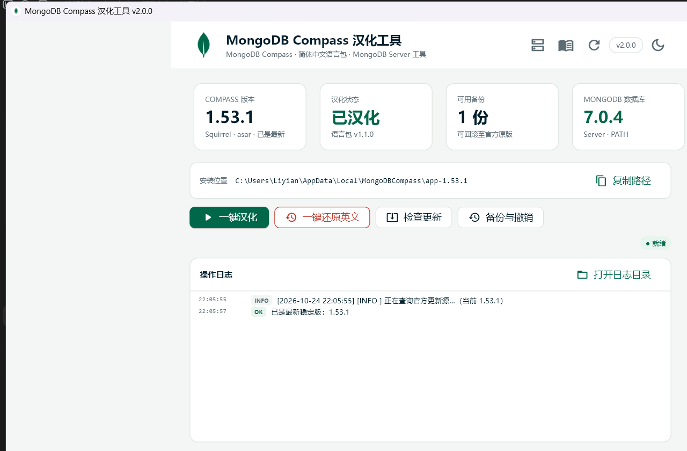
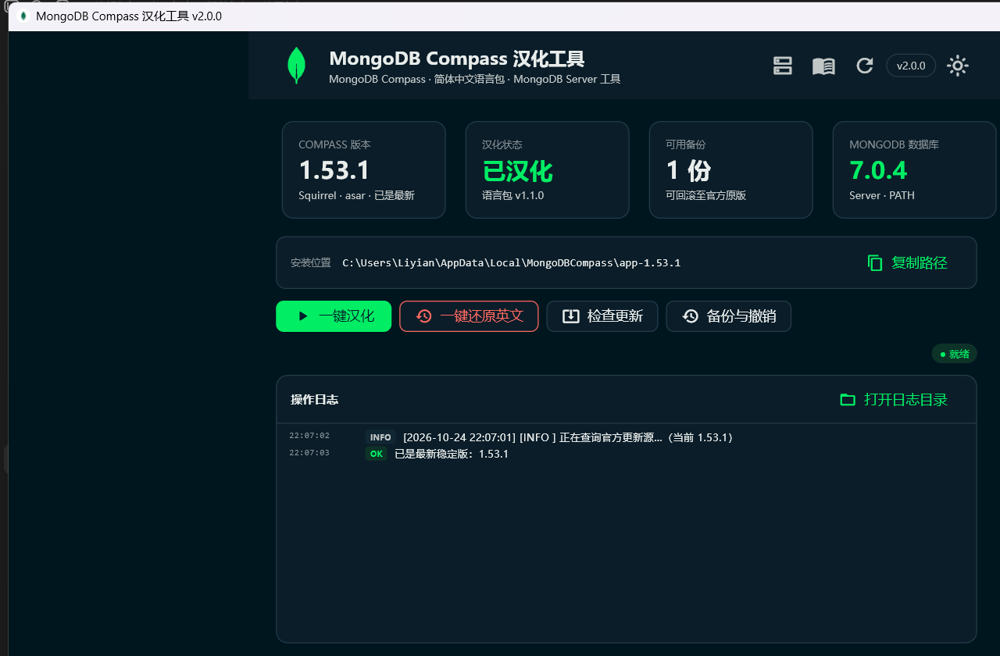
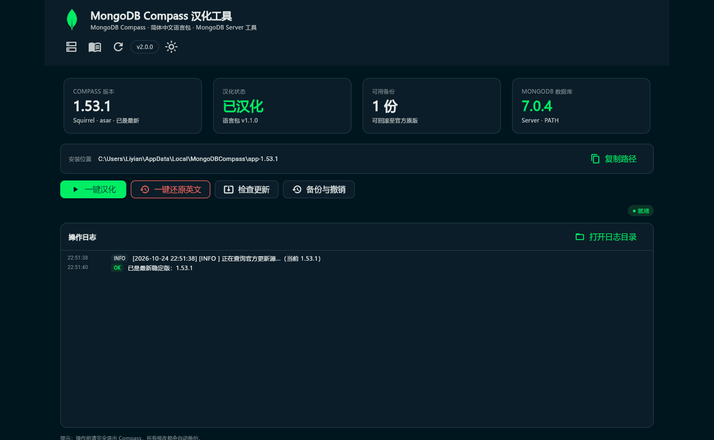
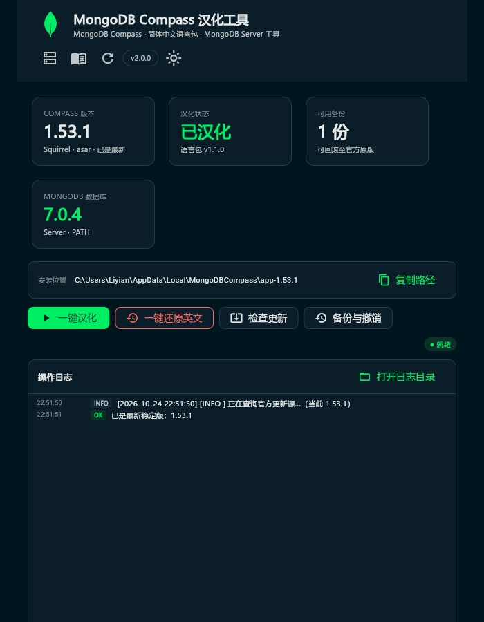
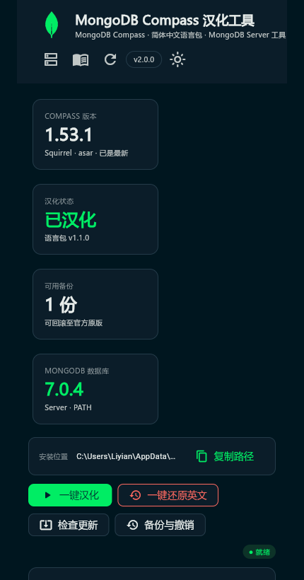
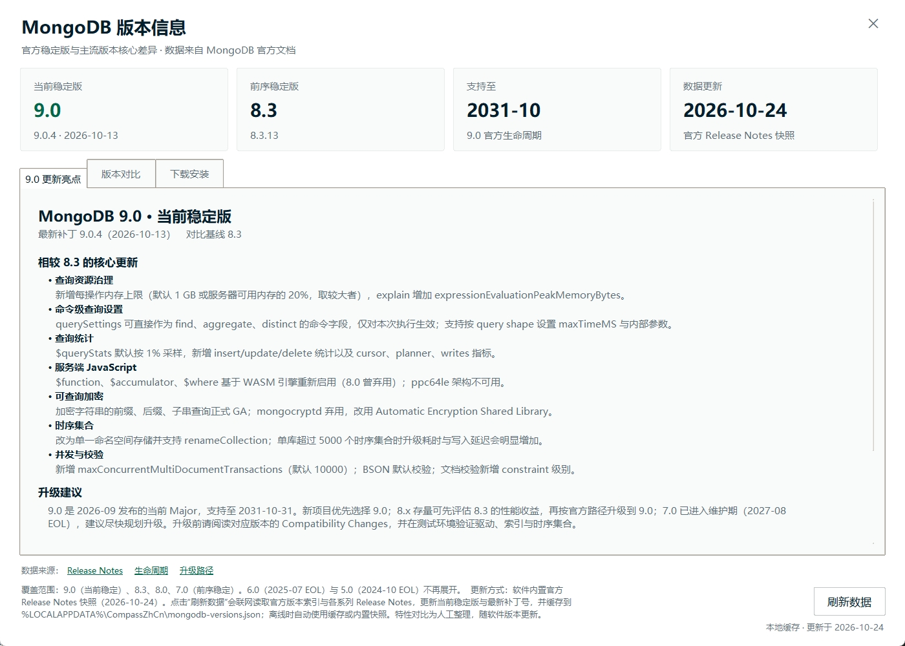
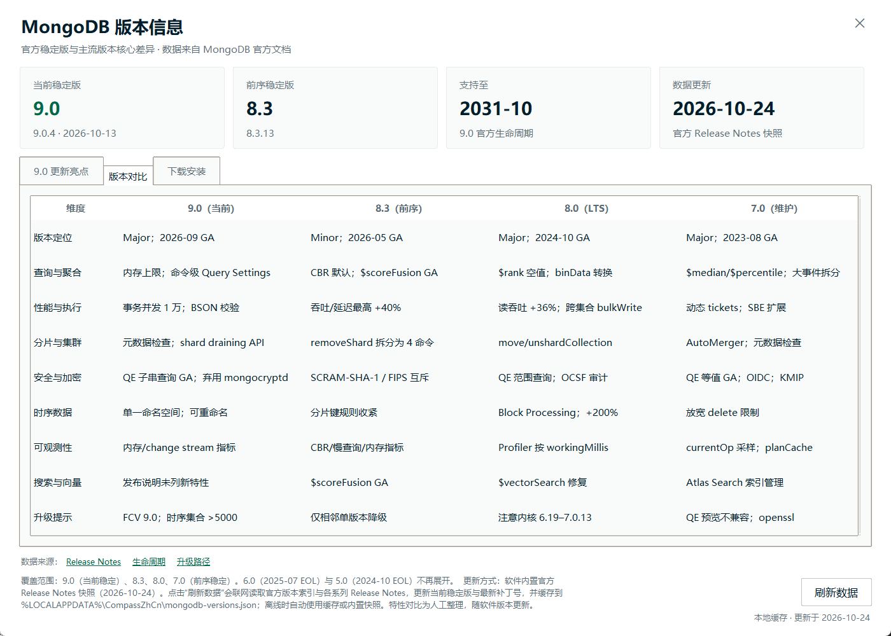

# MongoDB Compass 简体中文本地化工具

> 一款面向 Windows 的 MongoDB Compass 简体中文本地化工具：内置 1510 条渲染层词条、21 条动态文本规则和 36 项原生菜单翻译，支持一键汉化 / 还原、自动备份回滚、版本检测升级与 MongoDB 版本信息。
>
> **English**: A community-driven Simplified Chinese localization tool for MongoDB Compass on Windows, with one-click patching/restore, automatic backup & rollback, update detection, and a built-in MongoDB version guide.

[](LICENSE)
[](#系统要求)
[](#兼容性)

> 本项目为非官方社区项目，与 MongoDB, Inc. 无隶属关系。详见[许可与免责声明](#许可与免责声明)。

---

## 项目简介

MongoDB Compass 官方长期不提供简体中文界面。本项目通过**增量修改 `app.asar`** 的方式为 Compass 注入中文语言包与原生菜单翻译，做到：

- 不改动 Compass 业务代码，可随时**一键还原官方原版**；
- 修改前**自动备份**原始文件，支持按备份回滚；
- 首次汉化覆盖约 **95% 的常用界面文本**（连接、数据库/集合、文档 CRUD、聚合、索引、Schema、Explain、Shell、设置等）；
- 提供桌面客户端与 **Web 版**（浏览器访问本机工具），两者共用同一套界面与核心逻辑。

工具本身使用 Python 编写，图形界面基于 **Flet（Flutter）**，可打包为免安装单文件 exe 或 MSI 安装包。

---

## 主要功能

| 功能 | 说明 |
| --- | --- |
| 一键汉化 | 检测 Compass 进程 → 首次自动备份 → 写入语言包与菜单钩子 → 回读校验 → 提示重启 |
| 一键还原 | 校验备份完整性后覆盖回原版文件，SHA256 与官方一致 |
| 自动备份与回滚 | 每次汉化保留独立备份，支持历史列表与指定备份回滚 |
| 检查更新与升级 | 查询官方源，发现新版本可调用官方升级，升级后自动续汉化 |
| MongoDB 版本信息 | 9.0 / 8.3 / 8.0 / 7.0 版本亮点、九维对比、支持周期与官方来源 |
| MongoDB 下载安装 | 显示本机 Server 版本；下载官方 MSI（进度/取消/SHA256 校验）并启动安装 |
| 主机环境检测 | 自动定位 Compass 安装目录与 mongod；未安装时给出引导并禁用写操作 |
| 明暗主题 | 跟随 Compass 偏好，也可手动切换并记忆 |
| 桌面 / Web 双端 | 桌面绿色版、MSI 安装包、浏览器访问本机工具 |

---

## 本地化范围与进度

词表位于 `lang/zh-CN.json`，分为三部分：

| 模块 | 数量 | 状态 | 说明 |
| --- | ---: | --- | --- |
| `dict` 精确词条 | **1510** | ✅ 已完成 | 按钮、菜单、表单标签、空态、提示、对话框标题等固定文本 |
| `patterns` 动态规则 | **21** | ✅ 已完成 | 带变量/计数的句子（如 `N documents`、`Connected to {host}`） |
| `menu` 原生菜单 | **36** | ✅ 已完成 | 主进程 Electron 菜单（File/Edit/View/Help 等） |

**覆盖模块**：连接与连接管理、数据库与集合浏览、文档增删改查、聚合管道、索引管理、Schema 分析器、Explain 计划、嵌入式 Shell、设置页、导入导出、错误与确认对话框、原生应用菜单。

**明确不翻译**：代码块、`pre/code/textarea`、Monaco/Ace 编辑器内容、JSON 键名与值、查询栏、集合/字段名、日志原文、MongoDB 命令与错误码。

**尚未覆盖 / 已知边界**：
- 部分按需加载的 chunk 中仍有零散句子片段；
- 图表类 canvas 文本（如 Schema 图表内部标签）无法通过 DOM 注入翻译；
- 不同 Compass 小版本可能新增少量文案，欢迎通过 Issue/PR 补充。

详细统计与最新验证记录见 [`docs/DEVELOPMENT.md`](docs/DEVELOPMENT.md)。

---

## 界面预览

**桌面版（浅色 / 深色）**





**Web 版（响应式）**

| 宽屏 1280 | 窄屏 700 | 手机 430 |
| --- | --- | --- |
|  |  |  |

**MongoDB 版本信息与下载安装**





---

## 系统要求

- **操作系统**：Windows 10 / 11（x64）
- **MongoDB Compass**：官方 Squirrel 安装版，已测试 **1.53.0 / 1.53.1**
- **运行（使用打包产物）**：无需安装 Python
- **源码运行 / 构建**：Python 3.12+，Node.js 非必需

---

## 目录结构

```text
MongoDB-Compass-localization-ZHCN/
├─ CompassZhCn.py          # 核心：检测 / asar 增量注入 / 备份 / 还原 / 升级 / CLI
├─ flet_app.py             # Flet 图形界面（桌面 + Web 共用）
├─ web_app.py              # Web 版入口（127.0.0.1:8560）
├─ lang/
│  ├─ zh-CN.json           # 词表：dict(1510) + patterns(21) + menu(36)
│  ├─ inject.js            # 渲染层注入引擎模板
│  └─ main-hook.js         # 原生菜单钩子
├─ data/
│  └─ mongodb_versions.json# MongoDB 版本对比与支持周期快照
├─ assets/                 # 图标与界面资源（不含字体，见构建章节）
├─ docs/                   # README 截图与工程细节文档
├─ installer/
│  ├─ build_wxs.py         # 生成 WiX 安装脚本
│  ├─ version_info.txt     # exe 版本信息
│  └─ License.rtf          # 安装向导许可页
├─ scripts/
│  └─ prepare_font.py      # 从本机系统字体提取 Web 版中文字体
├─ 启动汉化工具.bat         # 桌面版启动脚本
├─ 启动Web版.bat           # Web 版启动脚本
├─ 还原英文.bat             # 应急还原
├─ 环境诊断.bat             # 环境与状态诊断
├─ requirements.txt        # Python 依赖
├─ CONTRIBUTING.md         # 贡献指南
├─ CHANGELOG.md            # 版本记录
├─ SECURITY.md             # 安全说明
└─ LICENSE                 # MIT
```

---

## 安装与构建

### 1. 源码运行

```bash
git clone https://github.com/stringyianlee/MongoDB-Compass-localization-ZHCN.git
cd MongoDB-Compass-localization-ZHCN

python -m venv .venv
.venv\Scripts\activate
pip install -r requirements.txt

python flet_app.py      # 桌面版
python web_app.py       # Web 版，自动打开 http://127.0.0.1:8560
python CompassZhCn.py --status   # 命令行
```

> Web 版需要中文字体，首次构建前执行 `python scripts/prepare_font.py`（从本机 `C:\Windows\Fonts\msyh.ttc` 提取 "Microsoft YaHei UI" 子字体）。字体属于微软系统字体，**不随仓库分发**。

### 2. 构建桌面单文件 exe

```bash
pip install pyinstaller
flet pack flet_app.py -n CompassZhCnFlet -i assets/compass.ico --distpath dist_flet ^
  --add-data "assets;assets" --add-data "lang;lang" --add-data "data;data" ^
  --add-data "docs;docs" --add-data "README.md;." ^
  --product-name "MongoDB Compass 汉化工具" --product-version "2.0.0" -y
```

### 3. 构建 Web 版 exe

```bash
pip install pyinstaller flet-web
pyinstaller --noconfirm --noconsole --icon assets/compass.ico --name CompassZhCnWeb ^
  --distpath dist_flet --onefile ^
  --add-data "assets;assets" --add-data "lang;lang" --add-data "data;data" ^
  --add-data "docs;docs" --add-data "README.md;." ^
  --collect-all flet_web --collect-all flet_platform_assets web_app.py
```

运行 `dist_flet\CompassZhCnWeb.exe` 后访问 `http://127.0.0.1:8560`。

### 4. 构建 MSI 安装包

需要 .NET SDK 与 WiX 5：

```bash
python installer/build_wxs.py
wix build installer/Product.wxs -ext WixToolset.UI.wixext -arch x64
```

生成脚本 `installer/Product.wxs` 含本机绝对路径，**已被 .gitignore 排除**，请勿提交。

### 5. 打包产物

| 产物 | 说明 |
| --- | --- |
| `dist\CompassZhCn-2.0.0-x64.msi` | 桌面版安装包（按用户安装，无需管理员） |
| `dist_flet\CompassZhCnFlet.exe` | 桌面版单文件绿色版 |
| `dist_flet\CompassZhCnWeb.exe` | Web 版独立服务器（内置 Web 运行时与字体） |

校验值见 `dist\SHA256SUMS.txt`（发布产物不进入 Git 仓库）。

---

## 使用方法

### 桌面版

1. 双击 `启动汉化工具.bat`，或运行安装后的快捷方式 / 绿色版 exe；
2. 完全退出 MongoDB Compass；
3. 点击「一键汉化」，等待日志提示完成；
4. 重新启动 Compass 即可看到中文界面。

需要恢复英文时点击「一键还原」；升级 Compass 后工具会自动提示并支持续汉化。

### Web 版

```bash
python web_app.py            # 默认 8560 端口，可用 FLET_WEB_PORT 修改
```

浏览器会自动打开；界面与桌面版一致，窄窗口/手机宽度下自动切换为换行与单列布局。

> Web 版是本机工具的浏览器形态，汉化/还原作用于**运行服务的这台机器**，默认仅监听 `127.0.0.1`。

### 命令行（可脚本化）

```bash
python CompassZhCn.py --status                  # 查看安装/汉化/备份状态
python CompassZhCn.py --apply                   # 汉化（交互确认）
python CompassZhCn.py --apply --yes --kill      # 无人值守：自动关闭 Compass 并汉化
python CompassZhCn.py --restore                 # 还原英文
python CompassZhCn.py --backups                 # 列出备份
python CompassZhCn.py --check-update            # 检查更新
python CompassZhCn.py --update --kill           # 升级并自动续汉化
python CompassZhCn.py --root "D:\Compass"       # 指定非默认安装目录
```

退出码：`0` 成功；`1` 业务错误；`2` GUI 启动失败；`130` 用户取消。

---

## 工作原理

1. **定位**：读取 `%LOCALAPPDATA%\MongoDBCompass\app-<版本>`，兼容注册表自定义安装路径，多版本取最高版本；
2. **备份**：首次修改前复制 `resources\app.asar` 到 `%LOCALAPPDATA%\CompassZhCn\backup`，记录 SHA256；
3. **增量注入**：解析 asar 头部，仅替换/新增必要条目并重算 integrity，保持其余条目 offset 不变；
   - 渲染层：`build/index.html` 末尾注入 `compass-zh-cn/zh-CN.js`；
   - 原生菜单：主进程 bundle 顶部注入 `main-hook.js` 钩子；
4. **校验**：回读注入结果并比对预期文件清单；
5. **还原**：用备份覆盖 `app.asar`，恢复官方 SHA256。

日志位于 `%LOCALAPPDATA%\CompassZhCn\logs\tool-YYYYMMDD.log`。

---

## 兼容性

| 项目 | 状态 |
| --- | --- |
| MongoDB Compass 1.53.0 / 1.53.1 | ✅ 已验证汉化、还原、升级续汉化 |
| 其他 1.5x 版本 | ⚠️ 结构相近，未逐一验证；差异可能导致部分文案回退英文 |
| Compass Isolated / 便携版 | ❌ 未支持（目录结构不同） |
| macOS / Linux | ❌ 未支持（路径与打包结构不同） |

---

## 贡献指南

欢迎补充词条、修复规则或改进界面，详见 **[CONTRIBUTING.md](CONTRIBUTING.md)**。快速上手：

1. Fork 并创建分支：`feat/xxx` 或 `fix/xxx`；
2. 修改 `lang/zh-CN.json`（`dict` / `patterns` / `menu`）或源码；
3. 运行 `python CompassZhCn.py --status` 与图形界面自测；
4. 提交 PR，说明修改范围与验证方式（附截图更佳）。

**请勿提交**：Compass 安装包、`app.asar`、备份文件、日志、系统字体、访问令牌或任何凭据。

---

## 许可与免责声明

本项目代码以 **[MIT License](LICENSE)** 发布，可自由使用、修改与分发（保留版权与许可声明）。

- 本项目为**非官方社区项目**，与 MongoDB, Inc. 无任何隶属或背书关系；
- **MongoDB**、**MongoDB Compass** 及相关标识是 MongoDB, Inc. 的商标，仅用于说明本工具的适用对象；
- 本项目**不包含** MongoDB Compass 的任何二进制、源代码或安装包，仅在用户本机对其安装目录做可逆的本地化修改；
- 仓库不包含微软雅黑字体，Web 版构建时由脚本从本机系统字体提取；
- 使用本工具造成的任何问题（包括但不限于 Compass 无法启动、升级失败）由使用者自行承担，建议操作前确认备份存在。

---

## 安全说明

- 工具全程离线工作，仅在「检查更新 / 刷新版本数据 / 下载 MongoDB」时访问官方域名；
- 不收集、不上传任何用户数据；
- 仓库与文档不包含密码、Token 或密钥。发现安全问题请见 [SECURITY.md](SECURITY.md)。

---

## 相关链接

- [MongoDB Compass 官方下载](https://www.mongodb.com/try/download/compass)
- [MongoDB 版本与生命周期](https://www.mongodb.com/support-policy/lifecycles)
- [工程细节与验证记录](docs/DEVELOPMENT.md)
- [版本记录](CHANGELOG.md)
