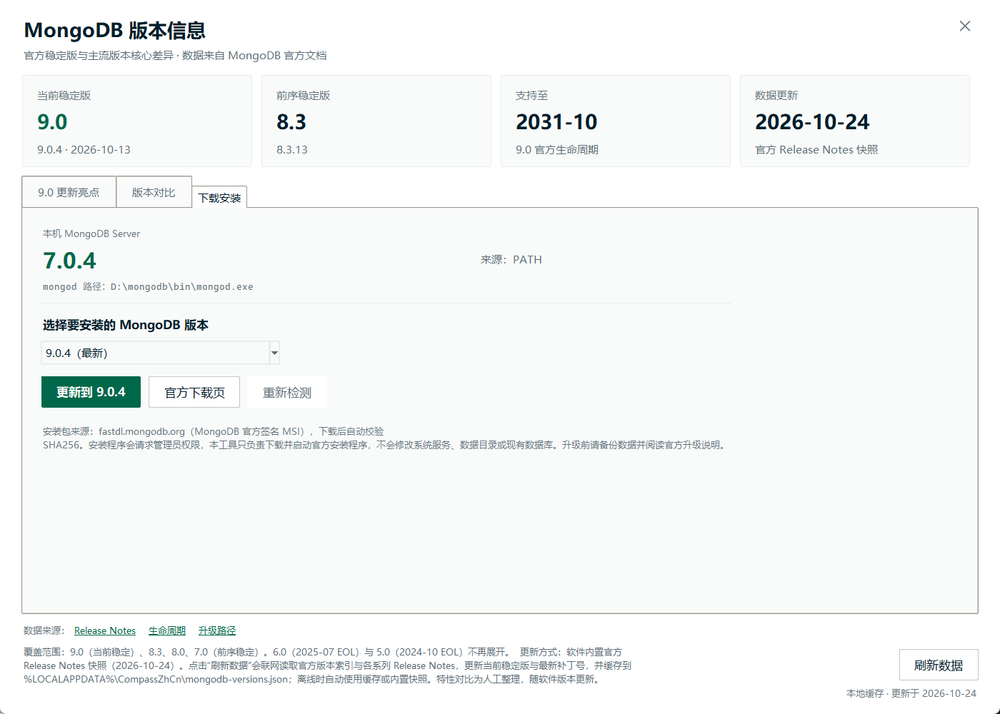

# MongoDB Compass 简体中文汉化工具

给 **MongoDB Compass 桌面版** 做界面汉化的独立工具：一键写入中文语言包，一键还原英文原版，改前自动备份、随时可回滚。

> 当前已验证环境：Windows 11 x64 + MongoDB Compass **1.53.0 / 1.53.1**（官方 Squirrel 安装版，`%LOCALAPPDATA%\MongoDBCompass`）
> 语言包版本：v1.1.0，词条 1510 条 + 21 条动态文本规则 + 36 项原生菜单
> 界面：**Flet（Flutter）** 重构的现代化桌面端，Material 3 控件 + Compass 绿色主题，支持明暗主题与高 DPI
> 安装包：`CompassZhCn-2.0.0-x64.msi`（内置运行时，无需 Python）


---

## 1. 系统环境与适用范围

| 项目 | 要求 |
| --- | --- |
| 操作系统 | Windows 10 / 11（x64）。工具依赖 Windows 的 Squirrel 安装结构与 `tasklist/taskkill`，暂不支持 macOS / Linux |
| Compass 来源 | 仅支持 **MongoDB 官方安装包**（Squirrel 安装版），默认路径 `%LOCALAPPDATA%\MongoDBCompass`，目录下存在 `app-<版本>\resources\app.asar` |
| Compass 版本 | 已适配 1.4x ~ 1.5x 的 Electron/asar 资源结构；在 **1.53.0** 上完成端到端验证。版本差异过大时工具会明确报错，不会强行写入 |
| 运行环境 | 工具本体用 Python 3.9+ 编写（GUI 使用标准库 tkinter，无第三方依赖）；**被汉化的 Compass 不需要 Python** |
| 权限 | 普通用户权限即可（安装目录在用户目录下）；若 Compass 装在 `Program Files`，需以管理员身份运行本工具 |
| 网络 | 仅在「检查更新 / 升级」时需要访问 `compass.mongodb.com`；汉化与还原完全离线 |

不支持：Microsoft Store 版、便携版（未打包目录形式，工具会提示）、Compass 的 Web 版。

---

## 2. 快速开始

1. **完全退出 Compass**（包括右下角托盘进程；GUI 会检测并询问是否代为关闭）。
2. 启动工具：安装 MSI 后从开始菜单/桌面打开，或源码方式双击 `启动汉化工具.bat`。
3. 点 **「一键汉化」**，等待日志出现 `汉化完成`。
4. 重新启动 Compass，界面即为简体中文。
5. 想变回英文：点 **「一键还原英文」**，工具用备份的原始 `app.asar` 完整覆盖，SHA256 校验一致后提示完成，重启 Compass 即可。

> 应急还原（不打开 GUI）：双击 `还原英文.bat`，或在命令行执行
> `python CompassZhCn.py --restore --kill`


### 2.1 使用 MSI 安装包（分享给他人）

发行文件：`dist/CompassZhCn-2.0.0-x64.msi`（约 72 MB，内置 Python 与 Flet/Flutter 桌面运行时，目标机**无需安装 Python**）。

1. 双击 MSI，按向导完成：许可协议 → 选择安装目录（默认 `%LOCALAPPDATA%\Programs\Compass汉化工具`）→ 安装 → 完成。
2. 安装**不需要管理员权限**（按当前用户安装），自动创建开始菜单与桌面快捷方式。
3. 卸载：设置 → 应用 → 已安装的应用 → **MongoDB Compass 汉化工具** → 卸载；或执行
   `msiexec /x {4F2E9B7C-8C13-4A6B-9E52-7D0B2A8F5C31}`。
4. 卸载只移除程序文件与快捷方式，**保留** `%LOCALAPPDATA%\CompassZhCn` 下的备份、日志与界面偏好，便于重装后继续回滚。
5. 安装包未做代码签名，Windows SmartScreen 可能提示“未知发布者”，选择“更多信息 → 仍要运行”即可；企业环境可自行签名。
6. 系统要求：Windows 10/11 x64，已安装官方 MongoDB Compass。工具启动时会自动读取 Compass 安装路径与版本，并与官方稳定通道比对：已是最新会显示“已是最新”，有新版本会在版本卡片提示“建议更新至 x.y.z”，点击「检查更新」可调用官方更新器升级，升级后自动为新版本重新汉化。

---

## 3. 界面设计与交互

界面使用 **Flet（Flutter）1.0** 全面重构：Material 3 控件、与 Compass 一致的绿色设计令牌、圆角卡片、明暗双主题。后端能力与调用方式完全不变，默认读取 Compass 当前主题（`AppPreferences/General.json` 的 `theme`）自动匹配明暗，也可在右上角切换，选择记录在 `%LOCALAPPDATA%\CompassZhCn\ui.json`。

**浅色主题（Flet）**


**深色主题（Flet）**


### 3.1 优化前 → 优化后

| 维度 | 优化前（Tkinter） | 优化后（Flet / Flutter） |
| --- | --- | --- |
| 渲染引擎 | Tkinter 自绘控件，高 DPI 下发虚 | Flutter Skia 渲染，文字/圆角/阴影原生级清晰 |
| 布局结构 | 单列堆叠、手写 grid 权重 | Material 布局体系：状态卡 4 等分、引导条、路径行、操作区、日志面板层次分明 |
| 视觉风格 | LeafyGreen 令牌手工绘制 | Material 3 + Compass 绿色令牌（`#00684A` / `#00ED64`），卡片、按钮、对话框统一组件库样式 |
| 交互一致性 | 自绘按钮模拟 hover/press | 原生 IconButton / FilledButton / OutlinedButton，自带 hover / 按下 / 焦点 / 禁用态 |
| 操作反馈 | 自绘进度线 + 状态徽标 | 不确定进度条 + 状态徽标（就绪/执行中），忙碌期间自动禁用写操作 |
| 术语与字号 | 9 / 10 / 17pt 手动阶梯 | 字号阶梯 10 / 11 / 18 / 24，语义色统一（成功/警告/危险） |
| 响应式 | 固定 980×690 最小尺寸 + 手写溢出检测 | 内容宽度自适应并居中，窗口缩放由 Flutter 布局引擎处理 |
| 可读性 | 低对比灰字、日志无层级 | 正文对比度 ≥ 4.5:1，日志按「时间 / 级别 / 内容」分色 |
| 高 DPI | 手动 SetProcessDpiAwareness + S() 缩放 | Flutter 原生 DPI 缩放，125% / 150% 下自动清晰 |
| 标题栏 | DWM 调用同步暗色 | Flutter 窗口管理，标题/图标随应用设置 |

### 3.2 交互细节

- **状态卡**：Compass 版本、汉化状态、可用备份三项一眼可见；汉化状态用成功色强调，备份卡提示是否可回滚。
- **主操作**：`一键汉化` 为实心主按钮；`一键还原英文` 使用危险色描边；`检查更新`、`备份与撤销` 为次级描边；`刷新状态`、`使用说明` 为文字按钮，层级清晰。
- **路径行**：等宽字体显示安装目录，中段省略保留尾部版本号；点击「复制路径」写入剪贴板并短暂提示。
- **日志面板**：时间戳弱化、级别着色、消息正常色；自动滚动只在用户已位于底部时触发，避免打断向上翻阅。
- **进度条**：不确定进度条平滑移动，任务结束自动收起；忙碌期间自动禁用刷新与写操作，防止写入中断。
- **提示条**：复制路径、汉化/还原完成等操作通过底部 SnackBar 轻量反馈。
- **窗口记忆**：主题与窗口尺寸持久化到 `ui.json`，下次启动恢复。

### 3.3 可读性与对比度（WCAG 2.1）

| 组合 | 对比度 |
| --- | --- |
| 浅色 正文 / 背景 `#001E2B` / `#FFFFFF` | 17.2:1 |
| 浅色 次要文字 / 背景 `#5C6C75` / `#FFFFFF` | 5.44:1 |
| 浅色 辅助文字 / 背景 `#66757D` / `#FFFFFF` | 4.77:1 |
| 浅色 主按钮文字 / 底色 `#FFFFFF` / `#00684A` | 6.82:1 |
| 浅色 危险文字 / 背景 `#DB3030` / `#FFFFFF` | 4.69:1 |
| 深色 正文 / 背景 `#E8EDEB` / `#001E2B` | 14.54:1 |
| 深色 主按钮文字 / 底色 `#001E2B` / `#00ED64` | 10.89:1 |

### 3.4 预期效果

- 打开工具 1 秒内即可判断「装的哪个版本、是否已汉化、有没有备份可回滚」。
- 主操作与危险操作在视觉上明确分离，减少误点「还原」。
- 汉化/还原/升级过程中有持续反馈，窗口不假死，日志可追溯。
- 在 125% / 150% 缩放下文字清晰，窗口缩放或最大化不出现裁切、重叠。
- 明暗主题与 Compass 保持一致，Material 3 动效让切换更自然，选择会被记住。

### 3.5 验证方式

| 验证项 | 方法 | 结果 |
| --- | --- | --- |
| 桌面启动 | `flet run`（开发）与 `flet pack` 单文件 exe（发布）分别启动 | Flutter 窗口正常，标题 `MongoDB Compass 汉化工具 v2.0.0` |
| 状态正确 | 启动后读取四张状态卡 | `1.53.1` / `已汉化 · 语言包 v1.1.0` / `1 份` / `7.0.4（PATH）` |
| 忙碌态 | 触发后台任务后检查按钮禁用与进度条；任务结束后恢复 | 写操作按钮禁用→恢复，进度条停止 |
| 主题切换/持久化 | 切换深色后读取 `ui.json`，再切回浅色 | `theme` 正确写入，界面即时变色 |
| 对话框 | 版本信息 / 备份与撤销 / 安装指引 / 确认框分别打开并截图 | 内容完整、按钮可操作，无溢出 |
| 自动更新检查 | 启动 1.5s 后台请求官方源 | 正确显示“已是最新稳定版：1.53.1” |
| MSI 安装 | `msiexec /i CompassZhCn-2.0.0-x64.msi /qn`（非管理员会话） | 退出码 0；37 个文件；ARP 显示 2.0.0 与安装位置 |
| MSI 卸载 | `msiexec /x {4F2E9B7C-…} /qn` | 退出码 0；目录/快捷方式/ARP 清理；备份保留 |
| 回归 | `--status`、`--check-update`、Tk 版 `--gui`（备用） | 全部通过，后端行为未变 |

### 3.6 MongoDB 版本信息模块

主界面右侧「MongoDB 版本」打开独立窗口，用于在不离开工具的情况下了解 MongoDB Server 的当前版本格局与升级方向。

- **版本概览**：当前稳定版 9.0、最新补丁 9.0.4、支持至 2031-10-31、数据更新日期。
- **更新亮点**：9.0 相较 8.3 的核心变化，包括每操作内存上限、命令级 Query Settings、`$queryStats` 默认采样、服务端 JavaScript 基于 WASM 回归、可查询加密前后缀/子串 GA、时序集合单一命名空间等，并给出升级建议。
- **版本对比**：9.0 / 8.3 / 8.0 / 7.0 四个主流版本，按版本定位、查询与聚合、性能与执行、分片与集群、安全与加密、时序数据、可观测性、搜索与向量、升级提示九个维度对比。
- **下载安装**：显示本机 MongoDB Server 版本与 mongod 路径；可选择 9.0.4 / 8.3.13 / 8.0.34 / 7.0.45，下载官方签名 MSI（约 0.6–1.0 GB），支持进度、取消与 SHA256 校验，完成后可启动官方安装程序；安装后点击「重新检测」刷新主页卡片。
- **数据来源**：MongoDB 官方 [Release Notes](https://www.mongodb.com/docs/manual/release-notes/)、[Lifecycle Schedules](https://www.mongodb.com/support-policy/lifecycles)、[Versions and Upgrade Paths](https://www.mongodb.com/docs/mongodb-versions/)，窗口内可直接点击打开。
- **覆盖范围**：9.0（当前稳定）、8.3、8.0、7.0（前序稳定）；6.0（2025-07 EOL）与 5.0（2024-10 EOL）不再展开，界面中已注明。
- **信息更新方式**：随软件内置 2026-10-24 的官方文档快照（`data/mongodb_versions.json`）。窗口内「刷新数据」会联网读取官方版本索引与各系列 Release Notes，更新当前稳定版与最新补丁号，并缓存到 `%LOCALAPPDATA%\CompassZhCn\mongodb-versions.json`；离线或抓取失败时自动回退到缓存/内置快照。特性摘要与支持周期为人工整理快照，随软件版本更新。

> 该模块只读取官方公开文档，不连接数据库、不修改 Compass，也不影响汉化/还原功能。



### 3.7 主机环境检测与安装引导

- **Compass 检测**：默认读取 `%LOCALAPPDATA%\MongoDBCompass`，并查询卸载注册表兼容自定义安装目录；检测到多个版本时取最高版本。
- **未安装引导**：主页显示黄色引导条「未检测到 MongoDB Compass」，提供「安装指引」与「下载 Compass」；「安装指引」给出官方下载、安装、启动、重新检测四步。此时汉化/还原/检查更新/备份按钮自动禁用，仅保留「刷新状态」与「MongoDB 版本」。
- **MongoDB 数据库卡片**：主页第 4 张卡显示本机 Server 版本（如 `7.0.4`）与来源（PATH / Program Files / 注册表）；未安装时显示「未安装」，并指向版本页的下载安装入口。
- **权限说明**：Compass 默认按用户安装，无需管理员；MongoDB Server 的官方 MSI 会请求管理员权限并可能注册 Windows 服务，属于正常安装行为，本工具不代替用户做静默安装。


## 4. 汉化覆盖范围

语言包由两部分组成：**渲染层**翻译页面文本、按钮、表单标签、占位符、悬浮提示与 `aria-label`；**主进程**翻译 Electron 原生菜单。不改动任何业务逻辑与用户数据。

**已覆盖**
- 启动/欢迎页、连接管理：新建/编辑连接、连接字符串、认证方式、TLS/SSL、SSH、代理、收藏与最近连接
- 左侧边栏：数据库与集合树、右键菜单、刷新/新建/删除/重命名、My Queries、Data Modeling
- 集合工作区：Documents / Aggregations / Schema / Indexes / Explain Plan / Validation 六个页签及各自的工具栏
- 文档浏览与编辑：查询栏（Filter/Project/Sort/Collation/Skip/Limit）、表格与 JSON 视图、插入/克隆/删除/批量操作、导出
- 聚合管道：阶段列表、阶段说明（$group/$lookup/$search 等）、添加/启用/禁用/复制/移动阶段、预览与结果、导出管道结果、创建视图
- 模式分析：采样、字段类型与取值统计、JSON Schema 关键字说明、模式导出、模式验证规则
- 索引：创建/删除索引、字段与排序方向、唯一/稀疏/部分/TTL/通配符/文本/地理空间等属性、Atlas Search 索引入口
- 导入/导出：文件类型、分隔符、字段选择、导入导出进度与结果提示
- 创建集合/数据库、重命名集合、时间序列选项、可查询加密（Queryable Encryption）等二级页面
- 设置、主题、功能预览、AI 助手（提问、生成查询/管道、清空对话等）
- 通用组件：按钮、确认弹窗、空状态、加载中、错误/成功提示、工具提示、页面标题
- **原生菜单栏**：File/Edit/View/Window/Help 及各子项（连接、导入导出连接、设置、日志、检查更新、缩放等），共 36 项

**不覆盖（保持原样，属有意为之）**
- Monaco / CodeMirror 代码编辑器内的查询语句、聚合管道 JSON、文档源码 —— 翻译会破坏语法与可执行性
- 文档内容本身（字段名、字段值、集合名、数据库名）以及导入预览里的用户数据
- 系统原生对话框（选择文件、另存为）、窗口标题栏按钮
- MongoDB 服务端返回的原始错误信息与堆栈、日志
- 编辑器内的 API 文档/自动补全（如 mongosh 帮助文本）与第三方库错误消息，保持英文以与官方文档一致
- 日期/数字/货币的本地化格式（仍为 Compass 默认格式）
- 少量第三方组件内部文案（如编辑器命令面板），以及 Compass 版本新增但词表尚未收录的文案（会保持英文，不会乱码）

> 词表是纯文本 JSON，可自行增补：编辑 `lang/zh-CN.json` 的 `dict`，重新点「一键汉化」即可生效。

---

## 5. 备份与回滚机制

**备份位置**

```
%LOCALAPPDATA%\CompassZhCn\
├─ backup\
│  └─ 1.53.0_20261023-235542\
│     ├─ app.asar        # 原始文件完整副本
│     └─ meta.json       # 版本、时间、SHA256、来源路径、备注
├─ logs\tool-YYYYMMDD.log
└─ state.json            # 当前安装的补丁状态与对应备份
```

**规则**
- 首次汉化前自动备份；同一版本再次汉化会**复用**原始备份，绝不会把已汉化的文件当成“原版”备份。
- 备份写入后立即计算 SHA256 并与源文件比对，不一致则中止。
- 每个 Compass 版本最多保留 **5 份**备份，超出按时间清理最旧的。
- 还原时先校验备份 SHA256，再写入临时文件、复验、替换，最后回读校验；任一步失败都不会破坏现有文件。
- 如果检测到旧版汉化工具遗留的 `resources\compass-zh-cn\app.asar.orig`，会先校验其确实未含语言包，再接管为本工具的备份（日志中有 `接管旧版…` 记录）。

**回滚方式**
- GUI：**「备份与撤销」** → 选择任意历史备份 → 「回滚到此备份」。
- 命令行：`python CompassZhCn.py --backups` 查看，`--restore-id <备份ID>` 回滚。

**异常兜底**：若汉化后 Compass 无法启动，直接运行 `还原英文.bat`（或 `python CompassZhCn.py --restore --kill`）即可恢复；备份文件本身也可手动复制回 `app-<版本>\resources\app.asar`。

---

## 6. 版本检测与升级

- 读版本：解析 `app.asar` 内 `package.json` 的 `version`，而不是目录名，避免误判。
- 查最新：请求官方稳定通道
  `https://compass.mongodb.com/api/v2/update/compass/stable/win32-x64/<当前版本>/RELEASES`
  - 返回 `204` 表示**已是最新**；
  - 返回 `200` 时从 `MongoDBCompass-<版本>-full.nupkg` 解析出最新版本号。
- 升级：调用 Compass 自带的 `Update.exe --update <官方源>`，轮询等待新的 `app-*` 目录出现（最多 10 分钟）。
- 升级完成后，若升级前处于汉化状态，工具会**自动对新版本重新注入**语言包；旧版本的备份仍保留，可单独回滚。
- 升级会下载约 180 MB，且 Compass 会被关闭/重启，工具在执行前会二次确认。

---

## 7. 三种使用方式

### A. 桌面图形界面（推荐）

双击 `启动汉化工具.bat`（Flet 版界面），或从源码运行：

```bash
pip install -r requirements.txt
python flet_app.py
```

界面包含：

- **状态卡**：安装目录、Compass 版本、汉化状态、可用备份数
- **一键汉化**：检测进程 → 自动备份（首次）→ 写入语言包 → 回读校验 → 提示重启
- **一键还原英文**：校验备份 → 覆盖 → 校验 → 提示重启
- **检查更新**：查询官方源，发现新版本可一键调用官方升级，并在升级后自动重新汉化
- **备份与撤销**：历史备份列表 + 指定备份回滚
- **操作日志**：彩色分级（INFO/OK/WARN/ERROR），可一键打开日志目录

### B. 命令行（可脚本化）

```bash
python CompassZhCn.py --status                # 查看安装/汉化/备份状态
python CompassZhCn.py --apply                 # 一键汉化（会提示确认）
python CompassZhCn.py --apply --yes --kill    # 无人值守：自动关 Compass 并汉化
python CompassZhCn.py --restore               # 还原英文
python CompassZhCn.py --restore-id 1.53.0_20261023-235542
python CompassZhCn.py --backups               # 列出备份
python CompassZhCn.py --check-update           # 只检查更新
python CompassZhCn.py --update --kill          # 升级到最新版（已汉化则自动续汉化）
python CompassZhCn.py --root "D:\\Compass"      # 指定非默认安装目录
```

退出码：`0` 成功；`1` 业务错误（已写入日志）；`2` GUI 启动失败；`130` 用户取消。

### C. Web 版（浏览器访问本机工具）

桌面与 Web 复用同一套 Flet 界面与核心逻辑（`flet_app.py`），Web 入口为 `web_app.py`，监听 `http://127.0.0.1:8560`：

```bash
pip install -r requirements.txt
python web_app.py            # 自动打开默认浏览器；端口可用 FLET_WEB_PORT 环境变量修改
```

或直接双击 `启动Web版.bat` / `dist_flet\CompassZhCnWeb.exe`（内置 Web 服务器与中文字体，免 Python）。

- **视觉与数据完全一致**：同一套明暗主题、状态卡、日志、备份、版本信息与 MongoDB 下载安装功能。
- **响应式布局**：宽屏四卡一行；平板/窄窗口卡片自动换行；手机宽度单列堆叠，按钮自动换行。
- **中文字体**：Web 渲染器（CanvasKit）不带系统字体，已内置微软雅黑 UI 字体资源（`assets/fonts/MicrosoftYaHeiUI.ttf`），中文渲染与桌面一致。
- **安全边界**：Web 服务默认只监听本机（127.0.0.1），汉化/还原等操作作用于**运行服务的这台机器**；如需局域网访问请自行评估风险（`python web_app.py` 配合 host 参数）。

> 兼容说明：v1.x 的 Tkinter 图形界面保留为备用，可用 `python CompassZhCn.py --gui` 打开；CI 或无 Flet 环境时可使用。

---

## 8. 工作原理

1. **增量改写 asar**：解析 Electron asar 的 Pickle 头，仅追加被修改/新增的条目，其余 1300+ 条目的 offset 与字节原样保留；被修改/新增的条目重算 SHA256 integrity（含 4 MiB 分块）。
2. **渲染层语言包**：脚本在 React 挂载前注入，遍历文本节点与 `placeholder/title/aria-label/aria-description/data-tooltip/alt`，用词表精确匹配 + 正则规则 + 冒号标签回退替换；`MutationObserver` 跟进后续渲染，并单独同步 `document.title`。
3. **主进程菜单钩子**：在 `build/42.js`（菜单所在主进程 chunk）顶部加一行受 try/catch 保护的 `require`，包装 `Menu.buildFromTemplate` 与 `Menu.setApplicationMenu`，按 `menu` 字典递归翻译菜单标签，保留 `&` 快捷键标记；钩子失效时静默跳过，不影响启动。
4. **安全边界**：`script/style/code/pre/textarea/option`、`contenteditable`、`.monaco-editor`、`.ace_editor`、文档列表/表格、查询栏等区域整块跳过；`data-testid`、class、事件、业务数据一律不碰。
5. **幂等**：重复汉化不会重复插入 `<script>` 或菜单钩子，只会用新词表覆盖语言包文件。

产物结构（asar 内）：

```
build/
├─ 42.js                          # 主进程菜单 chunk，顶部多一行 require（+78 字节）
├─ index.html                     # 仅多一行 script 引用
└─ compass-zh-cn/
   ├─ zh-CN.js                    # 渲染层语言包（词表 + 规则 + 注入引擎）
   ├─ main-hook.js                # 主进程 Menu 包装钩子
   └─ menu-zh-CN.json             # 原生菜单词表（36 项）
```

---

## 9. 日志与常见问题

日志：`%LOCALAPPDATA%\CompassZhCn\logs\tool-YYYYMMDD.log`，GUI 内也可直接查看。

| 现象 | 原因与处理 |
| --- | --- |
| `Compass 正在运行` | 完全退出 Compass（含托盘）；或在 GUI 确认由工具关闭，或命令行加 `--kill` |
| `无法写入 app.asar（文件被占用）` | 杀毒软件实时防护/索引器占用。工具会先重试、再退化为原地写入；仍失败时请暂时关闭实时防护后重试 |
| 汉化后界面仍是英文 | 未重启 Compass；或汉化的是旧版本目录而实际启动的是新版本。用 `--status` 确认「版本目录」与正在运行的 exe 一致 |
| 界面部分英文 | 该文案不在词表内（新版本新增文案），属正常降级；可自行补充 `lang/zh-CN.json` 后重新汉化 |
| Compass 升级后中文消失 | Squirrel 升级会生成新的 `app-*` 目录，补丁不会继承。重新点「一键汉化」，或直接「检查更新」让工具升级后自动续汉化 |
| 还原提示找不到备份 | 备份目录被清理。可用「备份与撤销」选择其它备份；或重新运行 Compass 官方安装包覆盖安装 |
| GUI 打不开 | 命令行运行 `python CompassZhCn.py --status` 查看具体报错；确认 Python 带 tkinter |

---

## 10. 卸载 / 恢复原版

1. 点「一键还原英文」恢复到官方原版；
2. 关闭工具，删除本工具目录；
3. 如需彻底清理运行时数据，删除 `%LOCALAPPDATA%\CompassZhCn`（内含备份与日志）。

还原后 `app.asar` 的 SHA256 与官方原文件完全一致（工具在还原后会复验），不会留下任何注入痕迹。

---

## 11. 本次验证记录（Compass 1.53.0）

| 验证项 | 方法 | 结果 |
| --- | --- | --- |
| asar 改写正确性 | 用 Electron 官方 `@electron/asar` 逐文件提取比对原始备份与写入后的 `app.asar` | 1302 个打包文件仅 `build/index.html`（+46 字节）与 `build/42.js`（+78 字节）变化；新增 `zh-CN.js`、`main-hook.js`、`menu-zh-CN.json`；无删除；268 个 unpacked 条目未改动 |
| 还原一致性 | 还原后计算 SHA256 与旧版工具留下的原始备份比对 | 完全一致（`bb04a7ed…648e51`） |
| 语言包语法 | `node --check zh-CN.js`、`node --check 42.js` | 均通过 |
| 渲染层行为 | 无头 Chrome 加载真实 payload + 模拟 DOM | 1510 条词表生效；`Filter:`→`筛选：`、`Index Fields: `→`索引字段： `、`1,234 documents examined`→`已检查 1,234 个文档`、`Stage 2`→`阶段 2`；`title`/`aria-description`/`data-tooltip`/动态节点均翻译；`code` 区域与输入值不变 |
| 菜单钩子 | 用模拟 `electron.Menu` 加载 `main-hook.js` | `&Connections`→`&连接`、`Check for updates…`→`检查更新…`、子菜单递归翻译，未知标签保持原样 |
| GUI | Python 3.14 + tkinter 启动自检、明暗主题截图 | 通过，见 `ui-light.png`、`ui-dark.png` |
| 版本检测 | 启动时自动请求官方稳定通道 RELEASES 接口 | Compass 已升级至 1.53.1 并由工具重新汉化；启动检查显示“已是最新” |
| MongoDB 版本模块 | 打开窗口、切换页签、刷新数据 | 4 张概览卡、9 行版本对比、9.0 更新亮点完整；刷新从官方文档更新至 9.0 / 9.0.4（约 20 秒）；失败自动回退本地快照 |
| MSI 安装 | `msiexec /i CompassZhCn-2.0.0-x64.msi /qn`（非管理员会话） | 退出码 0；写入 39 个文件（含 `data/mongodb_versions.json` 与 `` 截图）；开始菜单/桌面快捷方式；ARP 显示名称、版本、安装位置完整 |
| MSI 卸载 | `msiexec /x {4F2E9B7C-…} /qn` | 退出码 0；安装目录、快捷方式、ARP 项均清理；`%LOCALAPPDATA%\CompassZhCn` 备份保留 |
| Compass 未安装引导 | 模拟无安装启动 | 引导条显示；汉化/还原/检查更新/备份禁用，刷新状态可用 |
| MongoDB 数据库检测 | 调用 `mongod --version` 并交叉 PATH/注册表 | 正确识别本机 `7.0.4`（PATH） |
| Server 下载流程 | 确认 → 下载 → 取消 | 进度与体积显示正常；取消后 `.part` 清理，状态显示“已取消下载” |

**未能自动验证的一项**：Compass 实际窗口的中文渲染效果。原因是本工具的构建/运行环境带有进程沙箱，启动 Compass 时会拦截其依赖的系统调用并导致 GPU 进程崩溃（用**未打补丁的原版 asar** 同样复现，可排除补丁因素）。请在正常桌面会话中从开始菜单/快捷方式启动 Compass 查看；若界面异常，运行 `还原英文.bat` 即可恢复。

当前这台机器已写入 v1.1.0 语言包（Compass 1.53.1，1510 词条 + 36 菜单项），启动检查显示已是最新稳定版。备份位于 `%LOCALAPPDATA%\CompassZhCn\backup\1.53.1_20261024-015246`。

## 12. 目录结构

```
mongoDB-汉化\
├─ CompassZhCn.py          # 主程序（CLI + Tk 备用 GUI）
├─ flet_app.py             # Flet / Flutter 图形界面（桌面 + Web 共用）
├─ web_app.py              # Web 版入口（监听 127.0.0.1:8560）
├─ requirements.txt        # Python 依赖（flet / flet-desktop）
├─ 启动汉化工具.bat         # 打开 Flet 桌面图形界面
├─ 启动Web版.bat           # 启动 Web 版并打开浏览器
├─ 还原英文.bat             # 应急：命令行一键还原
├─ 环境诊断.bat             # 打印版本、状态、备份
├─ lang\
│  ├─ zh-CN.json           # 渲染词表（1510 条）+ 21 条规则 + 菜单词表（36 项）
│  ├─ inject.js            # 渲染层注入引擎模板
│  └─ main-hook.js         # 主进程 Menu 包装钩子
├─ data\
│  └─ mongodb_versions.json # MongoDB 官方版本对比快照
├─ assets\
│  ├─ compass.ico          # 窗口/任务栏图标（16–256px）
│  ├─ compass-logo.png     # 原始 276px 图标
│  └─ compass-mark*.png    # 标题栏叶形图标（明/暗两套，多尺寸）
├─ docs\
│  ├─ ui-light.png         # 浅色主题截图
│  ├─ ui-dark.png          # 深色主题截图
│  ├─ mongodb-versions.png # 版本概览与更新亮点
│  ├─ mongodb-compare.png  # 版本对比表
│  ├─ mongodb-install.png  # MongoDB 下载安装页
│  ├─ flet-ui-light.png    # Flet 浅色主题截图
│  ├─ flet-ui-dark.png     # Flet 深色主题截图
│  ├─ web-dark-wide.png    # Web 宽屏（1280）
│  ├─ web-dark-narrow.png  # Web 窄屏（700，卡片换行）
│  └─ web-dark-mobile.png  # Web 手机宽度（430，单列堆叠）
├─ installer\
│  ├─ Product.wxs          # WiX 安装脚本（由 build_wxs.py 生成）
│  ├─ build_wxs.py         # 生成安装脚本
│  └─ License.rtf          # 安装向导中的许可协议
├─ dist\
│  ├─ CompassZhCn.exe      # 单文件绿色版
│  └─ CompassZhCn-2.0.0-x64.msi  # MSI 安装包
└─ README.md
```

## 13. 版本记录

| 版本 | 变更 |
| --- | --- |
| v2.0.0 | 图形界面迁移到 **Flet（Flutter）1.0**：Material 3 控件、响应式布局、原生对话框/SnackBar；`flet pack` 单文件绿色版；新增 **Web 版**（同一套界面与逻辑，浏览器响应式访问，内置中文字体）；MSI 升至 2.0.0（内置 Flet 运行时） |
| v1.3.0 | 新增 Compass 安装检测与未安装引导、主页 MongoDB Server 版本卡片、版本页下载/安装 MongoDB（进度、取消、SHA256、启动官方 MSI）；MSI 升至 1.3.0 |
| v1.2.0 | 新增 MongoDB 版本信息模块（官方 Release Notes 快照 + 在线刷新 + 9.0/8.3/8.0/7.0 九维对比）；工具与安装包版本升至 1.2.0，MSI 更换 ProductCode |
| v1.1.0 | 新增 PyInstaller 自包含 exe 与 WiX MSI 安装包（按用户安装、无需管理员、标准卸载）；UI 重构：LeafyGreen 视觉体系、状态卡、自绘按钮与模态框、官方叶形图标、明暗主题、DPI 适配、响应式布局；补齐二级页面残留文案：主界面 chunk 缺口 554 → 58（其余为句子片段/事件名）；新增 688 条词条、7 条统计规则；支持 `Filter:` 冒号标签、`document.title`、`aria-description`/`data-tooltip`；新增原生菜单汉化（36 项，主进程钩子） |
| v1.0.0 | 首个版本：asar 增量注入、822 条词表、GUI/CLI、备份与回滚、版本检测升级 |

## 14. 说明

- 本工具只修改本地 Compass 的界面资源，不上传任何数据、不修改数据库、不触碰连接凭据。
- Compass 为 MongoDB Inc. 的商业产品，本工具与 MongoDB Inc. 无关联；升级 Compass 可能覆盖补丁，属正常现象。
- 汉化仅影响界面显示，MongoDB 命令、查询语法、导入导出格式仍遵循官方英文文档。
- 界面使用的 MongoDB Compass 图标取自本机 Compass 安装包（`app-icons`），商标归 MongoDB Inc. 所有，仅用于本地工具的界面标识。
- 使用前请确保已退出 Compass 并保留一份可用备份；生产环境建议先在测试机验证。
- 重新构建安装包：安装 `pip install -r requirements.txt pyinstaller` 后执行
  `flet pack flet_app.py -n CompassZhCnFlet -i assets/compass.ico --distpath dist_flet --add-data "assets;assets" --add-data "lang;lang" --add-data "data;data" --add-data "docs;docs" --add-data "README.md;." --product-name "MongoDB Compass 汉化工具" --product-version "2.0.0" --file-version "2.0.0" -y`
  生成 `dist_flet\CompassZhCnFlet.exe`；再运行 `python installer/build_wxs.py` 与
  `wix build Product.wxs -ext WixToolset.UI.wixext -arch x64`（需 .NET SDK 与 WiX 5）。
